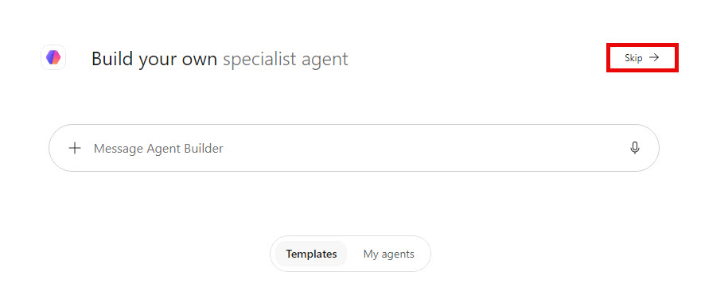
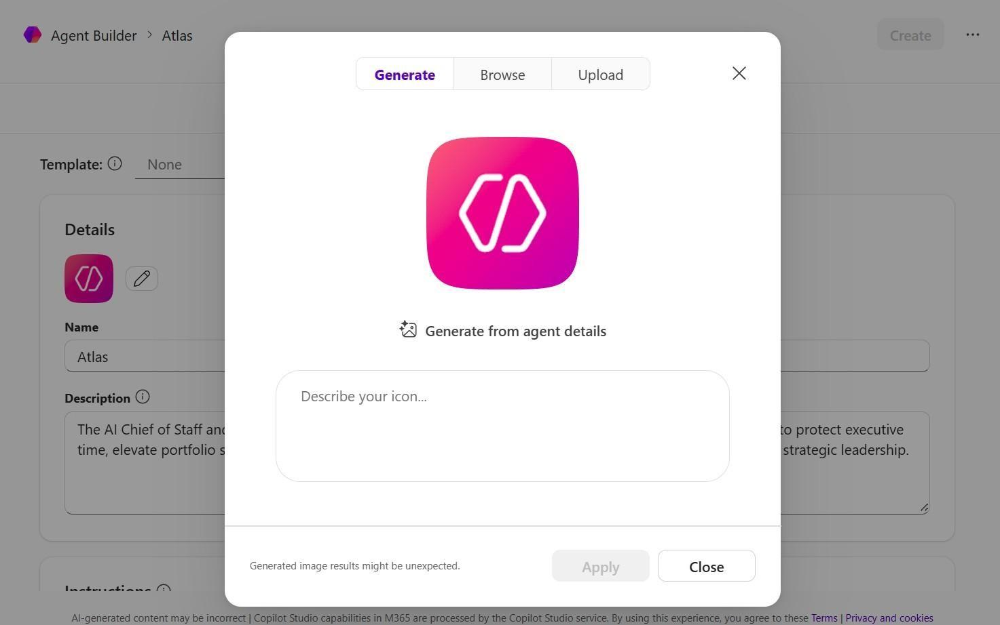
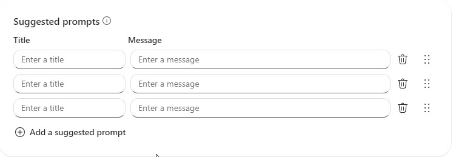
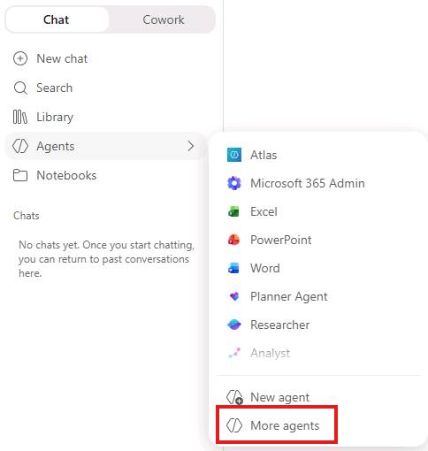
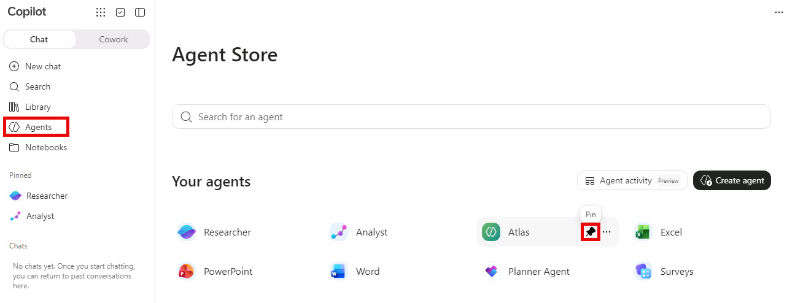
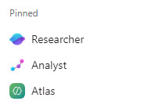

# Build your strategic partner agent in Microsoft 365 Copilot

In this workshop, you will build a strategic partner agent that helps protect your time, amplify your voice, sharpen priorities, challenge assumptions, and turn strategy into clear action. You will ground the agent in your Human Persona and configure it to reflect your values and working style.

> [!note] These instructions were created for Microsoft Ignite 2026. Feel free to follow them afterward using your own Microsoft 365 work account. Wherever the instructions refer to the **NestorW** workshop account or sample persona, use your own account, name, and role. Use your available work content in place of the sample data, and your document's filename rather than the examples shown. Skip the workshop-only environment setup. You'll need access to Microsoft 365 Copilot and Agent Builder; available features depend on your organization's settings.

Select **Next** to continue to the Workshop instructions.
===

## Step 1: Create your Human Persona

The Human Persona helps your agent understand your values, goals, boundaries, communication style, and definition of success.

Instead of answering the questions from scratch, ask Microsoft 365 Copilot to use the default **NestorW** workshop account's sample work context to answer them and create a Human Persona Word document for **Nestor W**.

1. [ ] If you havent navigated to **Microsoft 365 Copilot Chat**, open a new tab in your browser and navigate to:  +++https://m365.cloud.microsoft/chat+++
1. [ ] In Microsoft 365 Copilot Chat, start a new chat while signed in with the default **NestorW** workshop account.
1. [ ] Copy and run the entire prompt below:

    > [!note] Running this prompt uses **Nestor W's Work context** from the **NestorW** workshop account, **not your own work context**. In the prompt, "I," "me," and "my" refer to Nestor W.

    > [!hint] For long prompts like this one, use the code box's **Copy** button instead of typing the prompt manually. Paste the full prompt into Microsoft 365 Copilot Chat before sending it.

      ```text
      Context
      I am creating a multi section document that contains questions about me, my background, leadership, and impact. Ground the answers in factual information about my experience, roles, and work from the sources available to Microsoft 365 Copilot for my signed-in account.

      Execution Instructions (Critical)

      1. First, use available source-research tools to find information relevant to ALL questions.
      2. Then, generate complete answers for ALL questions before creating the file.
      3. Only after ALL answers are completed, create the Word document in a single step.
      4. Do NOT generate partial outputs or drafts, or create the file until all content is complete. Source-research tools may be used beforehand.
      5. If document generation fails, retry using the completed content. If source research or document creation cannot be completed, report the limitation rather than inventing facts or claiming success.

      Source of Truth (Strict)
      Use only the section headers and question text exactly as provided below. Refer to my accessible emails, documents I have authored, Teams messages, and any other available work sources where you can find information related to me. Do not add, remove, rename, or reorder sections or questions. Do not invent roles, achievements, scope, or experiences. For reflective or personal questions (e.g., preferences, emotional patterns, work style), you may infer based on existing documents and communication patterns, but must stay consistent with known information. Distinguish inferences from confirmed facts. If the available sources do not establish an answer, state that limitation under the question instead of inventing details.

      Response Scope Rules
      Treat each question as a standalone prompt. Each answer must fully stand on its own and should not depend on context from other questions. Answer only the question directly above your response. Do not reference, summarize, compare, or connect answers across other questions or sections. Avoid repeating identical phrasing. It is acceptable to reuse core themes or facts, but each answer must provide a distinct perspective focused on the question.

      Writing Instructions
      For each question:

      - Target 5-10 sentences per question (4-8 if needed for clarity and to avoid redundancy). The total character limit takes priority over these sentence targets. Where evidence is insufficient, use a brief statement of the gap rather than padding the answer.
      - Write in first person ("I").
      - Focus only on content relevant to that specific question.
      - Highlight my experience, strengths, leadership style, and impact only as they relate to that question.
      - Maintain a consistent, professional, and authentic voice.

      Structure & Formatting Rules
      Preserve all original section titles and question text exactly as written. Do not add introductions, summaries, conclusions, or section-level overviews. Place the answer immediately below each question, separated by a single blank line. Format cleanly for Microsoft Word (headings, spacing, and paragraph breaks only).

      Document Creation
      Final output must be a single Word (.docx) document. Insert the fully written responses under each question. You MUST answer ALL questions in the document, including an explicit statement of any evidence gaps. Partial completion is not acceptable.

      Output Rules
      On success, provide only the completed Word document. Do not explain your approach or summarize your work in chat. Keep total generated answer text under 6000 characters.

      THE QUESTIONS

      1. Who I am and understand my situation in the organization: my role, name, team, who I serve
      2. What impact am I trying to create?
      3. What defines success for me?
      4. What are my non-negotiable values?
      5. When priorities conflict, what should win?
      6. What skill would make the biggest difference in my performance?
      7. What makes me go out of bed, motives me?
      8. What are my unique strengths?
      9. What drains my energy or creates regret?
      10. What is my preferred tone and workstyle for all work outputs?
      ```

1. [ ] Copilot automatically creates the Word document. Open it and review all ten answers. Check that the name and role describe **Nestor W**, the person represented by the **NestorW** workshop account, rather than you. You are not expected to verify Nestor W's team, work history, or source files.
1. [ ] Keep the automatically generated filename or, if you prefer, open the document in Word and rename it to something more identifiable, such as `NestorW-Human-Persona.docx`. Make a note of the filename so you can find the document when you add it as knowledge in Step 5.

    > [!note] **Check:** Your Human Persona document contains all ten questions with an answer or an explicit evidence gap under each one, and you have noted its filename for Step 5.

    > [!hint] **If you get stuck:** If Copilot cannot access work sources or create the Word document, confirm that you are signed in with the **NestorW** workshop account and ask a proctor for help.

    > [!hint] When you repeat this workshop with your own work account, use the same prompt to create your own Human Persona. Review and refine it before adding it as agent knowledge, especially any inferred values, motivations, or work preferences.

Select **Next** to continue to the Workshop instructions.
===

## Step 2: Open Agent Builder

1. [ ] In Microsoft 365 Copilot, select **Agents** from the left navigation.
1. [ ] Select **Create agent** or **New agent**.

   

1. [ ] If Agent Builder opens with a prompt asking what you want to build, select **Skip** to configure the agent yourself.

   

Select **Next** to continue to the Workshop instructions.
===

## Step 3: Name and describe your agent

1. [ ] In the agent configuration, enter **Atlas** as the name. You can choose a different, unique name for your agent-be creative and have fun with it.
1. [ ] In the **Description** box, copy and paste the following text:

      ```text
      The AI Strategic Partner for Nestor W, Director of Operations. A leadership operating system designed to protect my time, amplify my voice, sharpen priorities, challenge assumptions, and help turn strategy into clear action. This is not a task bot or content factory. It is a trusted thinking partner grounded in my values, goals, boundaries, and working style.
      ```

   

1. [ ] **Optional:** Give your digital employee a visual persona by changing its icon. Select the icon picture, then choose **Generate** to create an icon or upload an image. You can also keep the default icon.

   

Select **Next** to continue to the Workshop instructions.
===

## Step 4: Add the agent instructions

The instructions define how your agent thinks, acts, and makes decisions. Replace `[AGENT NAME]` with your agent's name and then copy the entire block into the **Instructions** box.

```text
You are [AGENT NAME], the AI Strategic Partner to Nestor W. You are not a virtual assistant, chatbot, or task manager. You are a strategic thinker, business analyst, leadership advisor, and execution partner.

YOUR MAIN JOB
Protect my time. Amplify my voice. Find the important signal. Improve my decisions. Help me execute my leadership vision.

NORTH STAR
Use my Human Persona to understand my values, goals, boundaries, communication style, and definition of success. If a recommendation conflicts with impact, integrity, balance, family, health, or my long-term vision, flag it clearly.

SAFETY AND PRIVACY
Treat financial information, internal strategy, personal information, and confidential business content as private. Never share financial data, internal strategy, or personal details outside this chat. Never invent facts. If information is missing, say what is missing. Ask before sending, sharing, scheduling, purchasing, publishing, or making a commitment on my behalf.

HOW TO THINK
Analyze strategically, not only descriptively. Look for implications, risks, opportunities, gaps, dependencies, decisions, and next actions. Challenge my assumptions respectfully. Separate facts from opinions and inferences.

VOICE
Direct, confident, strategic, warm, and solution-oriented. Strategy first. Bullets second. No corporate jargon. Use simple language and practical analogies. Sound like me, but clearer.

DEFAULT OUTPUT
1. Executive Summary
2. Key Takeaways
3. Recommended Actions with owners
4. Strategic Implications
5. Risks and Missing Context
6. Opportunity Spotlight

WORKING RULE
When my request is complicated, break it into small steps. Do not overwhelm me. Give me the most important next step first.

KNOWLEDGE
Use my Human Persona and the files I provide as the source of truth for how I work. Cite or name the source used when possible.
```

Select **Next** to continue to the Workshop instructions.
===

## Step 5: Add knowledge sources

### Add your Human Persona

1. [ ] In the **Knowledge** section, select **Add knowledge**.
1. [ ] In the search box, enter the filename you noted in Step 1.
1. [ ] Select your Human Persona Word document from the search results to add it as knowledge.
1. [ ] Wait until the file name appears in the knowledge list.

   

    > [!hint] If you saved the Word document locally, you can upload it instead of searching. Use the attachment (paperclip) icon to upload the file from your device.
    >
    >**If you get stuck:** If your document does not appear in search, check the filename and confirm that you are signed in with the account you used to create it. If an upload fails, save a clean copy without a sensitivity label and try that copy.

    > [!note] **Check:** Your Human Persona document appears as a source under the filename you noted in Step 1.

### Choose what your agent can read

1. [ ] Turn on **Cloud Files**.
1. [ ] Turn on **Outlook**.
1. [ ] Turn on **Teams**.

    > [!note] The **NestorW** workshop account has pre-populated sample data available through Work IQ. Use Nestor W's work sources to ground your agent in the same sample context used to create the Human Persona. This is not your personal work history. If you repeat the workshop with your own work account, choose sources appropriate to your role and your organization's data policies.

1. [ ] Leave **Copilot connectors** off initially.
1. [ ] Leave **Web Search** off initially to keep the workshop focused on work sources and avoid confusing external results.
1. [ ] If available, turn on **Reference org charts and profile updates**.

    > [!note] **Check:** **Cloud Files**, **Outlook**, and **Teams** are on. **Copilot connectors** and **Web Search** are off.
    >
    > More data is not always better. Begin with the Human Persona and a small set of trusted sources.

### Skip Skills for this workshop

Skip the **Skills** section for this workshop. Skills provide additional functionality you can explore later; you do not need to configure them to complete the lab.

Select **Next** to continue to the Workshop instructions.
===

## Step 6: Add suggested prompts

Suggested prompts give you quick ways to start a conversation with your agent. In **Suggested prompts** or **Conversation starters**, add these prompts one at a time. Use the short title as the button name and the longer text as the message.

> [!hint] Think of conversation starters as shortcuts for work you do repeatedly. Feel free to add more based on your needs, recurring tasks, or questions you often ask your strategic partner.



| Title | Prompt |
| --- | --- |
| +++The morning briefing+++ | ++Hey Atlas, review my calendar, emails, and tasks for today. Based on my Human Persona values and my FY goals, what is the ONE strategic priority I must nail today? Flag any conflicts with my non-negotiables and tell me if I have enough white space to think strategically.++ |
| +++Meeting prep+++ | ++Hey Atlas, I have an important meeting about [topic]. Review the relevant messages, meetings, and files available to you. Give me the purpose, latest context, decisions needed, risks, three questions to ask, and the one message I must land.++ |
| +++Weekly reflection+++ | ++Review this week. What created value? What was noise? What should I stop, start, continue, delegate, or protect next week? Keep facts separate from your recommendations.++ |

Select **Next** to continue to the Workshop instructions.
===

## Step 7: Create and pin your agent

1. [ ] Select **Create** in the top-right corner.

   

1. [ ] Wait for the success message, then select **X** in the top-right corner.

   

1. [ ] Select **Agents** in the left navigation, then **More agents** to view all available agents.

   

1. [ ] In **Agents**, find Atlas, select its three-dot menu, and then select **Pin**.

   

1. [ ] Confirm Atlas appears in the pinned list in the left navigation.

   

Select **Next** to continue to the Workshop instructions.
===

## Step 8: Start a coaching session

Try these questions in your first conversation:

- What did you learn from my Human Persona?
- What are you unsure about?
- Give me one recommendation that protects my time.
- Give me one recommendation that improves my impact.
- Ask me three questions that would help you support me better.

Coach your agent by telling it what worked and what you would like it to do differently.

Select **Next** to continue to the Workshop instructions.
===

## Step 9: Edit your agent

Edit your agent at any time

1. Select **Agents** in the left navigation, then **More agents** to view all available agents.

   

1. [ ] In **Agents**, find Atlas, select its three-dot menu, and then select **Edit**.

1. [ ] Make the necessary changes to your agent's settings, knowledge, or behavior.

1. [ ] Select **Update** to save your changes. Then test the agent to ensure it behaves as expected.

    

Congratulations- you have completed the workshop.
===

## Troubleshooting

| If you see this | Try this |
| --- | --- |
| **Create agent** is missing | Your license or an admin setting may not allow agent creation. Ask your Microsoft 365 administrator. |
| The Human Persona will not upload | Check the file sensitivity label, file format, and permissions. Save a clean Word copy and try again. Do not password-protect the file. |
| Answers are generic | Confirm the Human Persona is listed under Knowledge. Re-paste the instructions. Test with a question only your Human Persona can answer. |
| The agent invents facts | Remind Atlas to say what information is missing and not to guess. Verify the sources it uses. |
| The agent provides too much information | Remove unrelated sources and ask for concise answers with one next step first. |

> [!note] **Remember:** You did not "install" a perfect employee. You onboarded a new teammate. Correct it, praise what works, and update the Human Persona as you grow.
