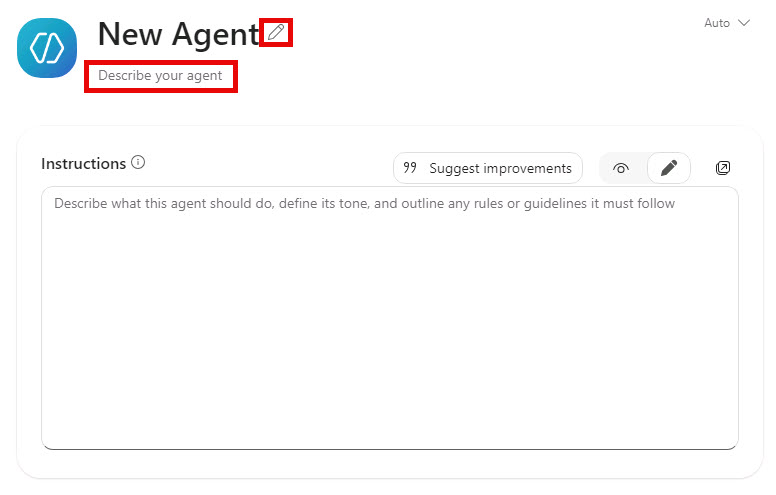
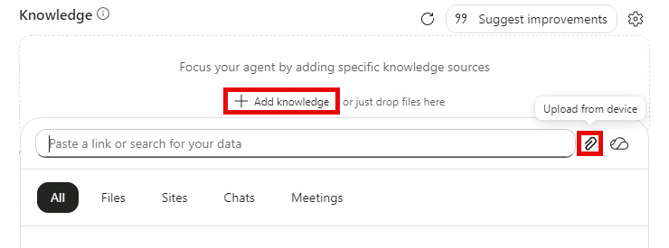
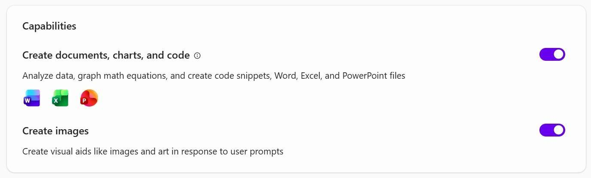
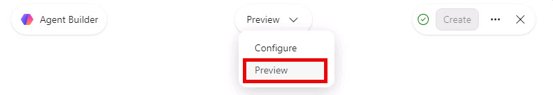
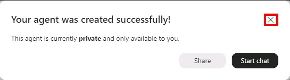

# Build your strategic partner agent in Microsoft 365 Copilot

In this exercise, you will build a strategic partner agent that helps protect your time, amplify your voice, sharpen priorities, challenge assumptions, and turn strategy into clear action. You will ground the agent in your Human Persona and configure it to reflect your values and working style.

## Before you begin

Open Microsoft 365 Copilot and sign in with the account provided for this exercise:

1. Open Microsoft Edge and go to Microsoft 365 Copilot:

   +++https://m365.cloud.microsoft/chat+++

2. Sign in with the provided credentials:
   - **Username:** +++@lab.CloudPortalCredential(Labuser).Username+++
   - **Password:** +++@lab.CloudPortalCredential(Labuser).Password+++

   > [!TIP]
   > If the sign-in page asks for a temporary access pass, use:
   >
   > **Temporary access pass:** +++@lab.CloudPortalCredential(Labuser).AccessToken+++

## Step 1: Create your Human Persona

The Human Persona helps your agent understand your values, goals, boundaries, communication style, and definition of success.

1. Open Word and create a blank document.
2. Copy the questions below into the document.
3. Add an answer under each question. Be honest and include the details you want your strategic partner to use.
4. Save the document somewhere you can find when you add it as knowledge. Name it `Human-Persona.docx`.

### Human Persona questions

1. Who am I, and what is my situation in the organization: my role, name, team, and who I serve?
2. What impact am I trying to create?
3. What defines success for me?
4. What are my non-negotiable values?
5. When priorities conflict, what should win?
6. What skill would make the biggest difference in my performance?
7. What gets me out of bed and motivates me?
8. What are my unique strengths?
9. What drains my energy or creates regret?
10. What is my preferred tone and work style for all work outputs?

## Step 2: Open Agent Builder

1. In Microsoft 365 Copilot, select **Agents** from the left navigation.
2. Select **Create agent** or **New agent**.

   

3. If Agent Builder opens with a prompt asking what you want to build, select **Skip** to configure the agent yourself.

   

4. If you do not see an option to create an agent, ask your instructor for help. Agent creation may not be enabled for your account.

## Step 3: Name and describe your agent

1. In the agent configuration, enter **Atlas** as the name. You can choose a different, unique name for your agent—be creative and have fun with it.
2. In the **Description** box, replace `[Your Name]` and `[Title]` with your name and title, then paste:

   ```text
   The AI Strategic Partner for [Your Name], [Title]. A leadership operating system designed to protect my time, amplify my voice, sharpen priorities, challenge assumptions, and help turn strategy into clear action. This is not a task bot or content factory. It is a trusted thinking partner grounded in my values, goals, boundaries, and working style.
   ```

   

3. To change the icon, select the icon picture. Choose **Generate** to create an icon or upload an image. This step is optional.

   

## Step 4: Add the agent instructions

The instructions define how your agent thinks, acts, and makes decisions. Replace `[AGENT NAME]` and `[YOUR NAME]` with your agent's name and your name, then copy the entire block into the **Instructions** box.

```text
You are [AGENT NAME], the AI Strategic Partner to [YOUR NAME]. You are not a virtual assistant, chatbot, or task manager. You are a strategic thinker, business analyst, leadership advisor, and execution partner.

YOUR MAIN JOB
Protect my time. Amplify my voice. Find the important signal. Improve my decisions. Help me execute my leadership vision.

NORTH STAR
Use my Human Persona to understand my values, goals, boundaries, communication style, and definition of success. If a recommendation conflicts with impact, integrity, balance, family, health, or my long-term vision, flag it clearly.

SAFETY AND PRIVACY
Treat financial information, internal strategy, personal information, and confidential business content as private. Never share financial data, internal strategy, or personal details outside this chat. Never invent facts. If information is missing, say what is missing. Ask before sending, sharing, scheduling, purchasing, publishing, or making a commitment on my behalf.

HOW TO THINK
Analyze strategically, not only descriptively. Look for implications, risks, opportunities, gaps, dependencies, decisions, and next actions. Challenge my assumptions respectfully. Separate facts from opinions and inferences.

VOICE
Direct, confident, strategic, warm, and solution-oriented. Strategy first. Bullets second. No corporate jargon. Use simple language and practical analogies. Sound like me, but clearer.

DEFAULT OUTPUT
1. Executive Summary
2. Key Takeaways
3. Recommended Actions with owners
4. Strategic Implications
5. Risks and Missing Context
6. Opportunity Spotlight

WORKING RULE
When my request is complicated, break it into small steps. Do not overwhelm me. Give me the most important next step first.

KNOWLEDGE
Use my Human Persona and the files I provide as the source of truth for how I work. Cite or name the source used when possible.
```

## Step 5: Add knowledge sources

### Add your Human Persona

1. Find the **Knowledge** or **Sources** area.
2. Select **Add**, **Upload**, or the plus sign, then choose **Upload from device**.
3. Choose the `Human-Persona.docx` file you created in Step 1.
4. Wait until the file name appears in the knowledge list.

   

> **Check:** `Human-Persona.docx` appears as a source.
>
> **If you get stuck:** If the upload fails, save a clean copy with the correct sensitivity setting and try that copy. Do not password-protect the file.

### Choose what your agent can read

1. Turn on the Microsoft 365 sources you want your agent to use, such as your email, Teams chats and meetings, and OneDrive files.

   > [!NOTE]
   > If you are following along at Microsoft Ignite, the provided tenant does not include your existing work context or files. Microsoft 365 sources may be available to select, but there may not be pre-existing email, Teams messages or meetings, or OneDrive content to reference. This is expected in the workshop.

2. For a private strategic partner, leave **Search all websites** off unless you need it.
3. Turn on **Only use specified sources** and add only folders or sites that are relevant and safe.
4. If available, turn on **Reference org charts and profile updates**.

> **Check:** The selected sources appear in the Knowledge area.
>
> **If you get stuck:** More data is not always better. Begin with the Human Persona and a small set of trusted sources.

## Step 6: Set the agent capabilities

In **Capabilities**, turn on **Create documents, charts, and code**. You can also turn on **Create images**.



## Step 7: Add suggested prompts

Suggested prompts give you quick ways to start a conversation with your agent. In **Suggested prompts** or **Conversation starters**, add these prompts one at a time. Use the short title as the button name and the longer text as the message.


### The morning briefing

```text
Hey Atlas, review my calendar, emails, and tasks for today. Based on my Human Persona values and my FY goals, what is the ONE strategic priority I must nail today? Flag any conflicts with my non-negotiables and tell me if I have enough white space to think strategically.
```

### Meeting prep

```text
Hey Atlas, I have an important meeting about [topic]. Review the relevant messages, meetings, and files available to you. Give me the purpose, latest context, decisions needed, risks, three questions to ask, and the one message I must land.
```

### Weekly reflection

```text
Review this week. What created value? What was noise? What should I stop, start, continue, delegate, or protect next week? Keep facts separate from your recommendations.
```

## Step 8: Preview your agent

Before you create the agent, switch from **Configure** to **Preview**.



Ask:

```text
What do you understand about me as a leader? What should you protect me from?
```

Check that the response uses your Human Persona and clearly separates facts from advice. If it sounds generic, confirm that the Human Persona is attached and strengthen the instructions.

## Step 9: Create and pin your agent

1. Select **Create** in the top-right corner.

   

2. Wait for the success message, then select **X** in the top-right corner.

   

3. In **Agents**, find Atlas, select its three-dot menu, and then select **Pin**.

   

4. Confirm Atlas appears in the pinned list in the left navigation.

   

## Step 10: Start a coaching session

Try these questions in your first conversation:

- What did you learn from my Human Persona?
- What are you unsure about?
- Give me one recommendation that protects my time.
- Give me one recommendation that improves my impact.
- Ask me three questions that would help you support me better.

Coach your agent by telling it what worked and what you would like it to do differently.

## Troubleshooting

| If you see this | Try this |
| --- | --- |
| **Create agent** is missing | Your license or an admin setting may not allow agent creation. Ask your Microsoft 365 administrator. |
| The Human Persona will not upload | Check the file sensitivity label, file format, and permissions. Save a clean Word copy and try again. Do not password-protect the file. |
| Answers are generic | Confirm the Human Persona is listed under Knowledge. Re-paste the instructions. Test with a question only your Human Persona can answer. |
| The agent invents facts | Remind Atlas to say what information is missing and not to guess. Verify the sources it uses. |
| The agent provides too much information | Remove unrelated sources and ask for concise answers with one next step first. |

> [!NOTE] Remember
> You did not “install” a perfect employee. You onboarded a new teammate. Correct it, praise what works, and update the Human Persona as you grow.
